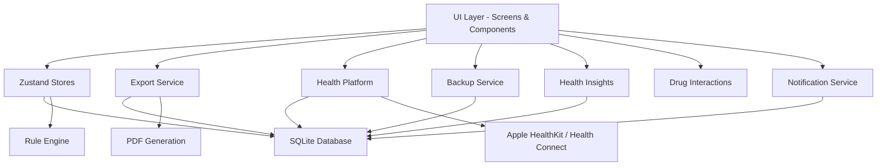

# VitaTrack

A local-first, offline-capable mobile health companion built with React Native and Expo. VitaTrack helps individuals and caregivers track personal vitals, manage medical information, monitor health trends, check drug interactions, and navigate medical emergencies using a rule-based triage engine — all without requiring cloud connectivity.

> VitaTrack is not a medical device. It does not provide diagnoses, treatment recommendations, or replace professional medical advice. Always consult a qualified healthcare provider for medical decisions.

---

## Features

- **Vital Tracking** — Log standard vitals (heart rate, blood pressure, SpO₂, temperature, blood glucose, respiratory rate, weight) and define custom vitals with custom names, units, and normal ranges.
- **Rule-Based Triage Engine** — A deterministic, offline symptom assessment tool that evaluates symptom flags and vital thresholds against a predefined rule set. Results are sorted by severity and include actionable guidance.
- **Health Insights** — Automated trend analysis generating warning, info, and positive insights for blood pressure, pulse, SpO₂, glucose, weight, and data consistency — powered by an in-memory cached engine.
- **Drug Interactions Checker** — Check 120+ known drug-drug interactions across major medication categories (ACE inhibitors, anticoagulants, SSRIs, beta-blockers, statins, NSAIDs, and more) with severity levels.
- **Health Platform Sync** — Bidirectional sync with Apple HealthKit (iOS) and Google Health Connect (Android) via a unified platform adapter pattern. Supports heart rate, blood pressure, weight, SpO₂, and step count.
- **Emergency Guidance** — Step-by-step emergency action screen with BEFAST stroke assessment, location sharing, and one-tap emergency calling.
- **Medication Management** — Structured medication logging with morning/afternoon/night dosage tracking, reminder scheduling via local push notifications, and automatic rescheduling on changes.
- **Condition & Allergy Tracking** — Card-based presentation of medical conditions and allergies for quick reference.
- **Emergency Contacts** — Manage primary and secondary emergency contacts with quick-dial support.
- **PDF & CSV Export** — Generate lab-report-style PDF exports or CSV reports for vitals history, medical ID summaries, medications, and alerts — fully offline, using on-device rendering.
- **Backup & Restore** — Full database backup as JSON with FK-safe restore, schema version validation, column sanitization, and 50 MB size limit.
- **Medical ID** — A one-page shareable summary of critical medical information (conditions, allergies, medications, contacts).
- **Dark Mode** — Full dark theme support across all screens, persisted via Zustand store.
- **Onboarding Flow** — Guided 4-screen onboarding (Welcome, Features, Setup Profile, Ready) shown on first launch.
- **Touch-Interactive Charts** — Tap or hold on chart data points in the History tab to see exact values and dates.
- **Offline-First** — All data is stored locally in SQLite. No account required, no data leaves the device.

---

## Tech Stack

| Layer              | Technology                                                              |
|--------------------|-------------------------------------------------------------------------|
| **Framework**      | React Native 0.81.5 with Expo SDK ~54                                  |
| **Language**       | TypeScript ~5.9                                                         |
| **Navigation**     | @react-navigation/native ^7.0, stack + bottom-tabs                     |
| **State**          | Zustand ^4.5                                                            |
| **Local Storage**  | expo-sqlite ~16.0 (SQLite on-device), 14 tables with FK relations      |
| **Charts**         | react-native-gifted-charts ^1.4, react-native-svg 15.12                |
| **Animations**     | react-native-reanimated ~4.1, react-native-gesture-handler ~2.28       |
| **PDF Generation** | expo-print ~15.0 + expo-file-system ~19.0 + expo-sharing ~14.0         |
| **Notifications**  | expo-notifications ~0.32 (local push reminders)                        |
| **Health (iOS)**   | react-native-health ^1.19 (Apple HealthKit)                            |
| **Health (Android)** | react-native-health-connect ^3.5 + expo-health-connect ^0.1         |
| **Icons**          | @expo/vector-icons ^15.0                                               |
| **Fonts**          | @expo-google-fonts/outfit, roboto-mono, syne                           |
| **Location**       | expo-location ~19.0                                                    |
| **Testing**        | Jest ~29.7, @testing-library/react-native ^13.3, jest-expo ~54         |

---

## Architecture

VitaTrack follows a layered architecture with clear separation between the UI, logic, data, and platform layers:

- **UI Layer** — React Native screens and components using a consistent design system defined in constants (colors, typography, spacing).
- **State Management** — Zustand stores (profile, settings, alert, theme) hydrated from SQLite on app start and kept in sync on mutation.
- **Database Layer** — Typed query functions in `src/db/queries/` executing raw SQL against a local SQLite database. Migrations run automatically on version changes.
- **Rule Engine** — Pure TypeScript function evaluating symptoms and vital thresholds against a deterministic rule set, producing sorted, severity-ranked results.
- **Health Insights Engine** — 8 detection functions analyzing recent vitals for trends (BP elevation, BP drop, pulse elevation, low SpO₂, glucose patterns, weight changes, no recent vitals, consistent normal readings).
- **Drug Interactions Engine** — 120+ interaction entries with severity-based categorization and case-insensitive partial name matching.
- **Export Service** — Three-tier architecture: HTML templates → PDF generation via expo-print, CSV generation, and an orchestrator with preview and share capabilities.
- **Health Platform** — Platform adapter pattern (`IOSAdapter` for Apple HealthKit, `AndroidAdapter` for Health Connect) with a lazy singleton and unified public API.
- **Backup Service** — JSON backup/restore with FK-safe restore (PRAGMA foreign_keys=OFF during re-insertion, reverse-dependency table clearing, schema version validation, column sanitization).

